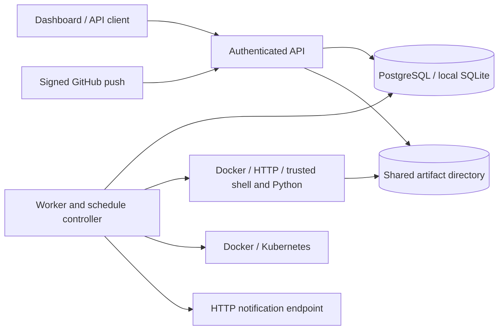

# TaskForge

TaskForge 0.2 is a self-hosted CI/CD and task automation system with a FastAPI control plane, independent execution workers, PostgreSQL or SQLite persistence, and a browser dashboard.

It supports **artifact-only pipelines, Docker deployment, and Kubernetes deployment**. Deployments promote a digest recorded by a successful build, can require a different administrator's approval, verify service health, and attempt to restore the previous release on failure.

## What is implemented

- Manual, cron, interval, one-shot, signed GitHub push, and secret-protected webhook triggers.
- Versioned job and pipeline definitions, immutable run snapshots, dependency validation, parallel independent steps, and verified artifact handoff to dependent steps.
- Standard CI/CD runner environment variables (`CI=true`, `TASKFORGE_PROJECT`, `TASKFORGE_RUN_ID`, `TASKFORGE_STEP`, `TASKFORGE_WORKSPACE`, `TASKFORGE_COMMIT`) and dynamic runtime parameters.
- Atomic queue claims, unique execution fences, worker heartbeats, resource locks, timeout/cancellation cleanup, durable standalone-job retries, and persisted attempts.
- Docker, HTTP, Python, and shell executors. Host execution is disabled by default.
- Project-scoped viewer/operator/admin bearer tokens; protected logs and artifacts; audit records; secret reference injection and log redaction.
- Content-addressed local artifacts with SHA-256 and a 50 MiB limit per file, with authenticated in-modal text preview for logs and manifests.
- Docker and Kubernetes adapters with immutable image validation, environment serialization, approvals, stale-build prevention, explicit rollback, and recovery reconciliation.
- Transactional notification queue with up to five HTTP delivery attempts and an idempotency key.
- Responsive dark/light dashboard: visual DAG workflow graphs, overview pulse, jobs, pipelines, run history with live streaming terminal and copy controls, deployments, integrations, and audit. Displays real persisted data and clear errors.
- GitHub Actions quality checks, Windows/Linux test matrix, PostgreSQL integration, Chromium UI tests, container smoke testing, and gated tag releases to GHCR.

This release is intended for trusted teams. It is not a hostile-code multi-tenant sandbox. Shell/Python can access their runner's host; Docker access also grants substantial control of the host. Keep execution workers separate from the API and isolate runners by trust boundary.

## Architecture



The API persists definitions and queues work; it does not execute workloads by default. Workers coordinate through the database. PostgreSQL is the team deployment backend; SQLite is for local development. API and workers must share the artifact directory at the configured `TASKFORGE_DATA_DIR`.

A missing worker heartbeat turns running work into `lost`. Work with unknown side effects is never automatically replayed. Standalone job retries release the worker slot and persist their next availability. Pipeline step retries remain within that pipeline execution; an interrupted pipeline requires review and a new run.

## Quick start

Python 3.11+ is required. From the repository root:

```powershell
python -m venv .venv
.\.venv\Scripts\python.exe -m pip install -e ".[dev,postgres,browser]"
.\.venv\Scripts\taskforge.exe init
.\.venv\Scripts\taskforge.exe server start
```

In a second terminal, from the same directory:

```powershell
.\.venv\Scripts\taskforge.exe worker start
```

Open **http://127.0.0.1:8080/**. Read the administrator token from the private `.taskforge/config.env` file and paste it into the login form. The separate release-reviewer token represents the approving identity. The dashboard keeps tokens only in memory and clears them on sign-out.

On Linux/macOS, use `.venv/bin/python` and `.venv/bin/taskforge` instead. The API fails startup if no valid tokens are configured. `taskforge init` never overwrites an existing configuration.

For a local Python/shell demonstration, add `TASKFORGE_ALLOW_HOST_EXECUTION=true` to the worker's environment and restart that worker. Enable this only for trusted job authors. Docker jobs require a working Docker CLI/engine; HTTP jobs require an allowed hostname.

See [install-steps.txt](install-steps.txt) for installation, Compose, migration, testing, and recovery steps.

## Configuration

Values come from process environment, then `.taskforge/config.env`, then `.env`, without overwriting existing values. Start the processes from the same working directory or configure absolute paths. JSON settings must be valid JSON; quote the whole value in dotenv files.

| Setting | Purpose / default |
| --- | --- |
| `TASKFORGE_STORAGE_URL` | `sqlite+aiosqlite:///taskforge.db`; PostgreSQL uses `postgresql+asyncpg://...` |
| `TASKFORGE_DATA_DIR` | Workspace and artifact root; `.taskforge` |
| `TASKFORGE_TOKENS` | JSON entries with `name`, `role`, `projects`, and a unique token of at least 32 characters |
| `TASKFORGE_WORKER_CONCURRENCY` | Concurrent runs per worker and parallel steps per pipeline; default 2 |
| `TASKFORGE_LEASE_SECONDS` | Execution heartbeat lease; default 30 |
| `TASKFORGE_ALLOW_HOST_EXECUTION` | Shell/Python opt-in; default false |
| `TASKFORGE_ALLOWED_HTTP_HOSTS` | Exact destination hostname list; default empty |
| `TASKFORGE_SECRETS` | Runner-only JSON map, e.g. `{"default/SERVICE_TOKEN":"..."}` |
| `TASKFORGE_GITHUB_REPOSITORIES` | Allowed `owner/repository` names |
| `TASKFORGE_GITHUB_SECRET` | GitHub webhook HMAC secret |
| `TASKFORGE_DEPLOYMENT_TARGETS` | Administrator-controlled Docker/Kubernetes targets |
| `TASKFORGE_NOTIFICATION_URL` | Optional HTTP endpoint receiving completed-run messages |
| `TASKFORGE_PLUGINS` | Installed entry-point plugin names explicitly permitted on a worker |
| `TASKFORGE_EMBEDDED_WORKER` | Development/testing only; default false |

Viewer tokens can inspect their projects. Operators can run, cancel, pause/resume, and request deployment. Administrators can change definitions, approve deployment, and reconcile environments. Project `"*"` grants all-project access. Definition IDs are globally unique within each definition kind.

Secret values belong in the runner environment, never job commands, repository files, or image layers. Reference a name such as `SERVICE_TOKEN` in `secret_refs`; the runner resolves `project/NAME`. Log redaction covers configured literal values, including values split across output chunks. Do not publish secrets in artifacts: artifact contents are not redacted.

Use TLS at your reverse proxy for remote access. Restrict worker credentials and egress to the services those workers need. Static tokens require manual rotation; OIDC and a managed secret store are follow-up work.

## Pipelines and artifacts

Create a pipeline through the dashboard JSON editor or `POST /api/pipelines`. [examples/artifact-pipeline.json](examples/artifact-pipeline.json) is a runnable Docker example: one step produces a file and another reads `inputs/build/package.txt`.

Each run captures the submitted definition version. `needs` defines dependencies; cycles and unknown step IDs are rejected. Failed dependencies skip their descendants. Artifacts are copied into dependent workspaces under `inputs/<step-id>/<filename>` after checksum verification.

Repository pipelines specify `repository: "owner/repo"` and `branch`. Manual runs supply a 40-character commit SHA. The worker fetches that public GitHub commit and verifies checkout. Signed pushes to the configured branch can queue the pipeline through `POST /api/triggers/github`. Replayed payloads are deduplicated. Fork pull requests and private repository authentication are not implemented.

Docker job containers have no network, dropped capabilities, bounded CPU/memory/PIDs, and a workspace mount. Build network access is not a job-supplied Docker flag. Prepare dependency images beforehand, or use a separately isolated trusted build runner. Artifact-only pipelines complete after verification and publication; they need no deployment target.

## Deployment targets

Configure both API and workers with the same target map. An example with all deployment adapters:

```json
{
  "docker-staging": {
    "type": "docker",
    "project": "default",
    "environment": "Staging",
    "image_repository": "ghcr.io/example/app",
    "container": "app-staging",
    "port": "127.0.0.1:18080:8080",
    "health_url": "http://127.0.0.1:18080/health",
    "require_approval": true
  },
  "kubernetes-production": {
    "type": "kubernetes",
    "project": "default",
    "environment": "Production",
    "image_repository": "ghcr.io/example/app",
    "context": "production",
    "namespace": "apps",
    "deployment": "app",
    "container": "app",
    "kubeconfig": "/run/secrets/kubeconfig",
    "require_approval": true
  }
}
```

Replace these examples with real infrastructure. The Docker worker needs Docker access; Kubernetes needs `kubectl`, the named context, an existing Deployment with readiness probes, and narrowly scoped cluster credentials. The default API image does not include Git, Docker, or kubectl; use a provisioned native worker or a separately built worker image. Compose does not mount the Docker socket.

A successful build must publish `release.json` containing `{"image":"repository/app@sha256:<64 lowercase hex characters>"}` in `artifact_paths`. The API verifies that artifact's checksum and image before accepting a deployment. This is trusted-build provenance, not a cryptographic build attestation.

1. Build/test once; push the image and record its immutable digest.
2. Publish `release.json` from the successful TaskForge build.
3. Select the source run, image digest, and configured target in Deployments.
4. A different administrator approves when required.
5. The worker rechecks the target configuration, serializes the environment, and verifies health/rollout.
6. On failure, the adapter attempts restoration. The environment remains locked until an administrator verifies the old worker stopped and inspects the service, then uses **Reconcile**.
7. To deploy an older successful build, an administrator chooses **Roll back to an older build**. Normal requests cannot overwrite a newer deployed build.

Docker deployment is a stop/start replacement with a backup container, so expect downtime. It is not blue/green deployment. Kubernetes changes the configured container image and waits for rollout; unsuccessful rollout attempts to restore the previous image. No live production target is provisioned by this repository.

## API and operations

Interactive API schemas are at `/docs`. Supply `Authorization: Bearer <token>` for API requests (including Swagger's requests via an external client if needed).

| Endpoint | Purpose |
| --- | --- |
| `GET /health`, `GET /ready` | API liveness and database readiness; readiness does not imply a worker is online |
| `GET /api/session`, `GET /api/system/stats` | Identity, scoped run counts, online worker count |
| `GET/POST /api/jobs` | List/save jobs; updates require the current `version` |
| `POST /api/jobs/{id}/run` | Queue immutable snapshot; optional `Idempotency-Key` |
| `POST /api/jobs/{id}/pause`, `.../resume` | Change persisted schedule |
| `DELETE /api/jobs/{id}?version=N` | Delete definition, preserving history |
| `GET/POST /api/pipelines`, `POST /api/pipelines/{id}/run` | Manage and run DAG pipelines |
| `GET /api/runs?limit=50&offset=0` | Paginated execution history |
| `GET /api/runs/{id}/logs?after=0` | Cursor-based logs |
| `GET /api/runs/{id}/attempts` | Persisted attempt records |
| `GET /api/runs/{id}/artifacts/{sha256}` | Authorized artifact download |
| `GET /api/runs/{id}/artifacts/{sha256}/preview` | Authenticated text preview (up to 256 KB) |
| `POST /api/runs/{id}/cancel` | Queued/running cancellation |
| `POST /api/deployments`, `.../{id}/approve`, `.../{id}/reconcile` | Deployment lifecycle |
| `GET /api/audit`, `GET /metrics` | Administrator audit records and persisted-state Prometheus metrics |

Cron accepts five or six fields and an IANA timezone. Intervals use positive expressions such as `every 5m`. One-shot timestamps require an offset, e.g. `2026-12-01T10:00:00+03:00`. Missed recurring ticks coalesce to one execution. Pausing a definition does not cancel already queued/running work.

## Validation and releases

```powershell
.\.venv\Scripts\ruff.exe check .
.\.venv\Scripts\ruff.exe format --check .
.\.venv\Scripts\mypy.exe taskforge
.\.venv\Scripts\bandit.exe -r taskforge -c pyproject.toml --severity-level medium
.\.venv\Scripts\pytest.exe --cov=taskforge
.\.venv\Scripts\python.exe -m build
.\.venv\Scripts\python.exe -m playwright install chromium
$env:TASKFORGE_BROWSER_TESTS="1"
.\.venv\Scripts\pytest.exe tests/browser
```

PostgreSQL tests use `TASKFORGE_TEST_POSTGRES_URL` and create/drop isolated test schemas. Live Docker testing uses `TASKFORGE_DOCKER_TESTS=1` and disposable named containers; it downloads a public Python image and exercises real rollback. Kubernetes adapter tests simulate kubectl success and failure; validate a real staging cluster before production use.

GitHub Actions runs the matrix and package/container checks. Protect the `release` environment with reviewers and restrict tag creation. A matching `v0.2.0` tag runs the checks before publishing the image to GHCR and the wheel, source archive, `release.json`, and checksums to a GitHub Release. Buildx requests SBOM and provenance attestations. Publishing a release does not automatically deploy a service.

## Current boundaries and next work

The core workflows are implemented, but operational rollout still needs your infrastructure and credentials. [implementation_plan.md](implementation_plan.md) records execution order and outstanding acceptance criteria.

Current limits: static token authentication; local shared artifact storage; no automatic retention; no private Git checkout or GitHub check-status reporting; no durable event-bus trigger; initial schema-version guard and legacy import rather than incremental Alembic migrations; capped definition lists (500 UI/API, 10,000 scheduler scan); pipeline recovery through a new reviewed run rather than checkpoint resume. Worker concurrency is per run, so multiple pipelines can each fan out up to the configured step limit. Dependencies use version ranges rather than a fully pinned lockfile.

Before a team rollout: configure TLS, PostgreSQL backups and restore testing, shared storage, isolated workers, protected release environments, real staging deployment smoke tests, and log/artifact retention. Add OIDC, managed secrets, dependency locking/scanning, external artifact storage, incremental migrations, and load/failure testing as the next engineering milestones.

## Documentation

- [Architecture contract](architecture.json)
- [Installation and operations](install-steps.txt)
- [Implementation and rollout plan](implementation_plan.md)
- [Engineering requirements](prompt.md)

Package metadata declares the MIT license.
