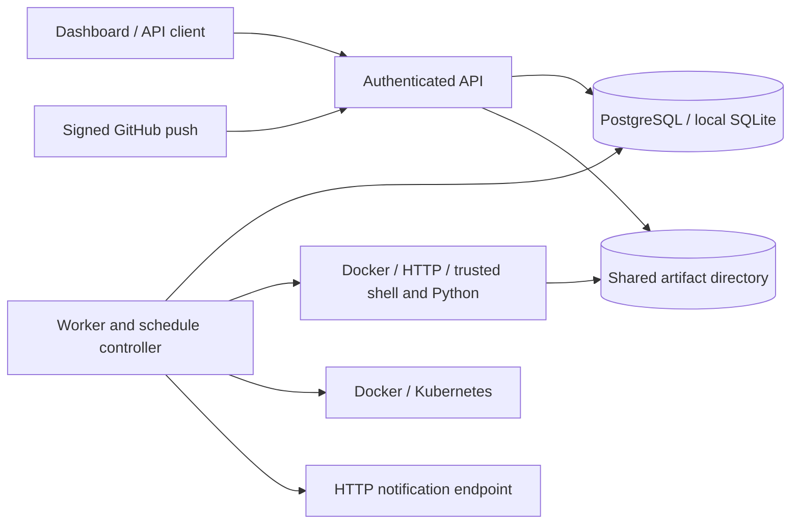

# TaskForge

TaskForge 0.4 is a self-hosted CI/CD and task automation system with a FastAPI control plane, independent execution workers, PostgreSQL or SQLite persistence, browser dashboard, and Jenkins Core feature parity.

It supports **Freestyle multi-step builds, artifact-only DAG pipelines, Docker deployment, and Kubernetes deployment**. Deployments promote a digest recorded by a successful build, can require a different administrator's approval, verify service health, and attempt to restore the previous release on failure.

## What is implemented

- **Jenkins Core Freestyle Multi-Step Builds**: Sequential step execution with independent executors (Shell, Python, Docker, HTTP) running inside a dedicated workspace (`workspaces/{job_id}/`).
- **Sequential Build Numbers**: Monotonically increasing atomic build numbers (#1, #2, #3...) tracked per job.
- **Parameterized Builds**: First-class build parameter definitions (`choice`, `string`, `boolean`, `text`, `password`), validated at queue time and injected into process environment variables.
- **Job Controls & Concurrency**: Enable/disable job toggle, quiet period queue delay (`quiet_period_seconds`), and serialized job concurrency mutex (`concurrent_builds: false`).
- **Interactive Workspace Management**: Built-in workspace tree explorer (`GET /api/jobs/{id}/workspace`), file content viewer, and 1-click workspace wipe.
- **Permalinks**: Permanent direct endpoints to `last`, `lastSuccessful`, `lastFailed`, and `lastStable` runs and archived build artifacts.
- **Deterministic Jenkins H-Cron**: Hash-based cron scheduling (`H/15 * * * *`, `H(0-29)/10 * * * *`, `H H(0-7) * * *`) seeded deterministically by job ID to spread scheduling load across time.
- **Upstream / Downstream Build Triggers**: Chain jobs automatically upon build completion based on threshold conditions (`SUCCESS`, `UNSTABLE`, `ALWAYS`) with full upstream cause lineage.
- **Ant/Glob Artifact Archiving**: Output artifact archiving with include and exclude patterns (`artifact_paths`, `artifact_exclude_paths`) preserving relative directory structures, byte sizes, and digests.
- **Artifact Fingerprints & Lineage**: SHA-256 and MD5 fingerprint registry tracking artifact provenance and usage across jobs and runs.
- **Discard Old Builds (LogRotator)**: Automated build retention enforcing maximum builds and retention age in days, while strictly preserving runs flagged `keep_forever` and milestone permalinks.
- **Setup Wizard & Password Unlock**: First-run setup wizard unlocked via `initialAdminPassword` secret with admin user creation and standard tool installation.
- **Global Tool Management**: Define named tools (NodeJS, Go, Maven, Python) with automatic worker process `PATH` prepending.
- **Remote API Tree Filtering**: Jenkins-compatible `?tree=...` query selector syntax across jobs and runs endpoints for lightweight querying.
- **Comprehensive CLI**: `taskforge build` (with `--param`, `--wait`, `--follow`), `taskforge console` (with `--follow`), and `taskforge artifacts`.
- Manual, cron, interval, one-shot, signed GitHub push, and secret-protected webhook triggers.
- Declarative YAML/JSON task definitions for standalone jobs and multi-step DAG pipelines, multi-document streaming (`---`), live syntax dry-run validation, sensitive secret redaction on export, and `taskforge apply` CLI support.
- Dashboard declarative task creation dialog with quick-start templates (Python cron, Docker task, Shell script, CI/CD pipeline), live validation badges, and 1-click clipboard copy / file download.
- Versioned job and pipeline definitions, immutable run snapshots, dependency validation, parallel independent steps, and verified artifact handoff to dependent steps.
- Standard CI/CD runner environment variables (`CI=true`, `TASKFORGE_PROJECT`, `TASKFORGE_RUN_ID`, `TASKFORGE_STEP`, `TASKFORGE_WORKSPACE`, `TASKFORGE_COMMIT`) and dynamic runtime parameters.
- Atomic queue claims, unique execution fences, worker heartbeats, resource locks, timeout/cancellation cleanup, durable standalone-job retries, and persisted attempts.
- Docker, HTTP, Python, and shell executors. Host execution is disabled by default.
- Project-scoped viewer/operator/admin bearer tokens; dynamic database-persisted user management with secure token generation, rotation, and revocation; protected logs and artifacts; audit records; secret reference injection and log redaction.
- Content-addressed local artifacts with SHA-256 and a 50 MiB limit per file, with authenticated in-modal text preview for logs and manifests.
- Docker and Kubernetes adapters with immutable image validation, environment serialization, approvals, stale-build prevention, explicit rollback, and recovery reconciliation.
- Transactional notification queue with up to five HTTP delivery attempts and an idempotency key.
- Responsive dark/light dashboard: visual DAG workflow graphs, overview pulse, jobs, pipelines, run history with live streaming terminal and copy controls, deployments, integrations, users & access management, setup wizard, and audit trail.
- GitHub Actions quality checks, Windows/Linux test matrix, PostgreSQL integration, Chromium UI tests, container smoke testing, and gated tag releases to GHCR.

This release is intended for trusted teams. It is not a hostile-code multi-tenant sandbox. Shell/Python can access their runner's host; Docker access also grants substantial control of the host. Keep execution workers separate from the API and isolate runners by trust boundary.

## Architecture



The API persists definitions and queues work; it does not execute workloads by default. Workers coordinate through the database. PostgreSQL is the team deployment backend; SQLite is for local development. API and workers must share the artifact directory at the configured `TASKFORGE_DATA_DIR`.

A missing worker heartbeat turns running work into `lost`. Work with unknown side effects is never automatically replayed. Standalone job retries release the worker slot and persist their next availability. Pipeline step retries remain within that pipeline execution; an interrupted pipeline requires review and a new run.

## Quick start

Python 3.11+ is required. From the repository root:

```powershell
python -m venv .venv
.\.venv\Scripts\python.exe -m pip install -e ".[dev,postgres,browser]"
.\.venv\Scripts\taskforge.exe init
.\.venv\Scripts\taskforge.exe server start
```

In a second terminal, from the same directory:

```powershell
.\.venv\Scripts\taskforge.exe worker start
```

Open **http://127.0.0.1:8080/**. Read the administrator token from the private `.taskforge/config.env` file and paste it into the login form. The separate release-reviewer token represents the approving identity. The dashboard keeps tokens only in memory and clears them on sign-out.

On Linux/macOS, use `.venv/bin/python` and `.venv/bin/taskforge` instead. The API fails startup if no valid tokens are configured. `taskforge init` never overwrites an existing configuration.

For a local Python/shell demonstration, add `TASKFORGE_ALLOW_HOST_EXECUTION=true` to the worker's environment and restart that worker. Enable this only for trusted job authors. Docker jobs require a working Docker CLI/engine; HTTP jobs require an allowed hostname.

### Docker Compose Stack (API, Worker, PostgreSQL)

To run the complete TaskForge stack with an API server, background execution worker, and PostgreSQL database via Docker:

From the repository root:
```powershell
docker compose -f docker/docker-compose.yml up --build -d
docker compose -f docker/docker-compose.yml ps
```

Or from the `docker/` directory:
```powershell
cd docker
docker compose up --build -d
docker compose ps
```

The stack exposes:
- **API & Web Dashboard**: `http://127.0.0.1:8080/dashboard/`
- **Readiness Probe**: `http://127.0.0.1:8080/ready`
- **PostgreSQL Database**: Port 5432 with automatic schema initialization

`POSTGRES_PASSWORD` is configured in `docker/.env` (and root `.env`) with an automated fallback in [docker-compose.yml](docker/docker-compose.yml). Custom credentials can be specified in `.env` or via shell environment variables.

See [install-steps.txt](install-steps.txt) for installation, Compose, migration, testing, and recovery steps.

## Configuration

Values come from process environment, then `.taskforge/config.env`, then `.env`, without overwriting existing values. Start the processes from the same working directory or configure absolute paths. JSON settings must be valid JSON; quote the whole value in dotenv files.

| Setting | Purpose / default |
| --- | --- |
| `TASKFORGE_STORAGE_URL` | `sqlite+aiosqlite:///taskforge.db`; PostgreSQL uses `postgresql+asyncpg://...` |
| `TASKFORGE_DATA_DIR` | Workspace and artifact root; `.taskforge` |
| `TASKFORGE_TOKENS` | JSON entries with `name`, `role`, `projects`, and a unique token of at least 32 characters |
| `TASKFORGE_WORKER_CONCURRENCY` | Concurrent runs per worker and parallel steps per pipeline; default 2 |
| `TASKFORGE_LEASE_SECONDS` | Execution heartbeat lease; default 30 |
| `TASKFORGE_ALLOW_HOST_EXECUTION` | Shell/Python opt-in; default false |
| `TASKFORGE_ALLOWED_HTTP_HOSTS` | Exact destination hostname list; default empty |
| `TASKFORGE_SECRETS` | Runner-only JSON map, e.g. `{"default/SERVICE_TOKEN":"..."}` |
| `TASKFORGE_GITHUB_REPOSITORIES` | Allowed `owner/repository` names |
| `TASKFORGE_GITHUB_SECRET` | GitHub webhook HMAC secret |
| `TASKFORGE_DEPLOYMENT_TARGETS` | Administrator-controlled Docker/Kubernetes targets |
| `TASKFORGE_NOTIFICATION_URL` | Optional HTTP endpoint receiving completed-run messages |
| `TASKFORGE_PLUGINS` | Installed entry-point plugin names explicitly permitted on a worker |
| `TASKFORGE_EMBEDDED_WORKER` | Development/testing only; default false |
| `POSTGRES_PASSWORD` | PostgreSQL superuser password used by Docker Compose; defaults to secure fallback |

Viewer tokens can inspect their projects. Operators can run, cancel, pause/resume, and request deployment. Administrators can change definitions, approve deployment, and reconcile environments. Project `"*"` grants all-project access. Definition IDs are globally unique within each definition kind.

Secret values belong in the runner environment, never job commands, repository files, or image layers. Reference a name such as `SERVICE_TOKEN` in `secret_refs`; the runner resolves `project/NAME`. Log redaction covers configured literal values, including values split across output chunks. Do not publish secrets in artifacts: artifact contents are not redacted.

Use TLS at your reverse proxy for remote access. Restrict worker credentials and egress to the services those workers need. Static tokens require manual rotation; OIDC and a managed secret store are follow-up work.

## Declarative YAML task definitions

All tasks—both standalone scheduled jobs and multi-step DAG pipelines—can be defined, imported, exported, and managed in human-readable YAML.

YAML eliminates escaped newlines and quote escaping, making multiline shell and Python scripts clean and maintainable.

### Example: Scheduled Job in YAML ([examples/hello_world_job.yaml](examples/hello_world_job.yaml))

```yaml
id: job-hello-world
name: hello-world
project: default
description: Simple hello world demonstration job defined in YAML
trigger: interval
trigger_expr: every 1m
executor: shell
command: echo 'Hello from TaskForge at %TIME%!'
status: active
tags:
  - demo
  - getting-started
  - yaml
```

### Example: Multi-step DAG Pipeline in YAML ([examples/artifact-pipeline.yaml](examples/artifact-pipeline.yaml))

```yaml
id: artifact-demo
project: default
name: Build and verify an artifact
version: 0
description: Multi-step verification pipeline defined cleanly in YAML
steps:
  - id: build
    needs: []
    job:
      id: build
      project: default
      name: Build
      trigger: manual
      executor: docker
      image: python:3.12-alpine
      command: |
        python -c "from pathlib import Path; Path('package.txt').write_text('verified package'); print('Built package')"
      artifact_paths:
        - package.txt

  - id: verify
    needs:
      - build
    job:
      id: verify
      project: default
      name: Verify
      trigger: manual
      executor: docker
      image: python:3.12-alpine
      command: |
        python -c "from pathlib import Path; assert Path('inputs/build/package.txt').read_text() == 'verified package'; print('Artifact verified')"
```

### Applying and exporting tasks via Dashboard and CLI

- **Dashboard**:
  - Click **📄 Add from YAML** in the Jobs or Pipelines header.
  - Pick from quick-start templates (Python cron, Docker task, Shell script, CI/CD pipeline).
  - Click **🔍 Validate YAML** to dry-run syntax and model validation before persisting.
  - Click **Apply task definition** to persist jobs or pipelines.
  - Click **YAML** on any job row or pipeline card to open the export modal with 1-click **📋 Copy YAML** and **⬇ Download .yaml**.
  - Pipeline editing natively loads and saves in YAML.
- **CLI**:
  ```powershell
  $env:TASKFORGE_API_TOKEN = "your-admin-token"

  # Declaratively apply single or multi-document YAML files
  .\.venv\Scripts\taskforge.exe apply examples/hello_world_job.yaml
  .\.venv\Scripts\taskforge.exe apply examples/artifact-pipeline.yaml

  # Create tasks directly from YAML
  .\.venv\Scripts\taskforge.exe jobs create examples/hello_world_job.yaml
  .\.venv\Scripts\taskforge.exe pipelines create examples/artifact-pipeline.yaml

  # Export definition as YAML to stdout or file
  .\.venv\Scripts\taskforge.exe jobs yaml job-hello-world
  .\.venv\Scripts\taskforge.exe pipelines yaml artifact-demo
  ```

## Pipelines and artifacts

Create a pipeline through the dashboard YAML editor, `POST /api/pipelines/yaml`, or `POST /api/pipelines`. [examples/artifact-pipeline.yaml](examples/artifact-pipeline.yaml) is a runnable Docker example: one step produces a file and another reads `inputs/build/package.txt`.

Each run captures the submitted definition version. `needs` defines dependencies; cycles and unknown step IDs are rejected. Failed dependencies skip their descendants. Artifacts are copied into dependent workspaces under `inputs/<step-id>/<filename>` after checksum verification.

Repository pipelines specify `repository: "owner/repo"` and `branch`. Manual runs supply a 40-character commit SHA. The worker fetches that public GitHub commit and verifies checkout. Signed pushes to the configured branch can queue the pipeline through `POST /api/triggers/github`. Replayed payloads are deduplicated. Fork pull requests and private repository authentication are not implemented.

Docker job containers have no network, dropped capabilities, bounded CPU/memory/PIDs, and a workspace mount. Build network access is not a job-supplied Docker flag. Prepare dependency images beforehand, or use a separately isolated trusted build runner. Artifact-only pipelines complete after verification and publication; they need no deployment target.

## Users and role-based access control (RBAC)

TaskForge supports dynamic user provisioning stored in SQLite/PostgreSQL with SHA-256 hashed token lookup, alongside bootstrap static credentials in `.taskforge/config.env`.

Access is governed by three hierarchical roles and explicit project scopes:

| Role | Permissions |
| --- | --- |
| **`admin`** | Full authoring and operational privileges: create/edit/delete jobs and pipelines, manage deployments and approvals, provision team users, rotate/revoke access tokens, and inspect audit records. |
| **`operator`** | Operational control: trigger pipeline executions, pass runtime parameters, pause/resume jobs, cancel running jobs, and request deployments. Cannot modify job/pipeline definitions or manage users. |
| **`viewer`** | Read-only visibility: inspect pipeline DAGs, execution history, live streaming logs, and download/preview build artifacts. |

### Managing users via Dashboard or CLI

- **Dashboard**: As an `admin`, navigate to **Users & access** in the sidebar. Click **+ Add user**, assign their role and project scope (`*` for all projects or a comma-separated list of project IDs), and copy the auto-generated 48-byte token. Generated access tokens are presented once upon creation.
- **CLI**:
  ```powershell
  $env:TASKFORGE_API_TOKEN = "your-admin-token"

  # List users
  .\.venv\Scripts\taskforge.exe users list

  # Create an operator user
  .\.venv\Scripts\taskforge.exe users create alice --role operator --projects "backend,web"

  # Revoke a user
  .\.venv\Scripts\taskforge.exe users delete alice
  ```

## Deployment targets

Configure both API and workers with the same target map. An example with all deployment adapters:

```json
{
  "docker-staging": {
    "type": "docker",
    "project": "default",
    "environment": "Staging",
    "image_repository": "ghcr.io/example/app",
    "container": "app-staging",
    "port": "127.0.0.1:18080:8080",
    "health_url": "http://127.0.0.1:18080/health",
    "require_approval": true
  },
  "kubernetes-production": {
    "type": "kubernetes",
    "project": "default",
    "environment": "Production",
    "image_repository": "ghcr.io/example/app",
    "context": "production",
    "namespace": "apps",
    "deployment": "app",
    "container": "app",
    "kubeconfig": "/run/secrets/kubeconfig",
    "require_approval": true
  }
}
```

Replace these examples with real infrastructure. The Docker worker needs Docker access; Kubernetes needs `kubectl`, the named context, an existing Deployment with readiness probes, and narrowly scoped cluster credentials. The default API image does not include Git, Docker, or kubectl; use a provisioned native worker or a separately built worker image. Compose does not mount the Docker socket.

A successful build must publish `release.json` containing `{"image":"repository/app@sha256:<64 lowercase hex characters>"}` in `artifact_paths`. The API verifies that artifact's checksum and image before accepting a deployment. This is trusted-build provenance, not a cryptographic build attestation.

1. Build/test once; push the image and record its immutable digest.
2. Publish `release.json` from the successful TaskForge build.
3. Select the source run, image digest, and configured target in Deployments.
4. A different administrator approves when required.
5. The worker rechecks the target configuration, serializes the environment, and verifies health/rollout.
6. On failure, the adapter attempts restoration. The environment remains locked until an administrator verifies the old worker stopped and inspects the service, then uses **Reconcile**.
7. To deploy an older successful build, an administrator chooses **Roll back to an older build**. Normal requests cannot overwrite a newer deployed build.

Docker deployment is a stop/start replacement with a backup container, so expect downtime. It is not blue/green deployment. Kubernetes changes the configured container image and waits for rollout; unsuccessful rollout attempts to restore the previous image. No live production target is provisioned by this repository.

## API and operations

Interactive API schemas are at `/docs`. Supply `Authorization: Bearer <token>` for API requests (including Swagger's requests via an external client if needed).

| Endpoint | Purpose |
| --- | --- |
| `GET /health`, `GET /ready` | API liveness and database readiness; readiness does not imply a worker is online |
| `GET /api/system/setup-status`, `.../unlock`, `.../complete` | Setup wizard state and first-run administrator unlock |
| `POST /api/auth/login` | Session login using administrator password |
| `GET /api/session`, `GET /api/system/stats` | Identity, scoped run counts, online worker count |
| `GET/POST /api/jobs` | List/save jobs (supports `?tree=` filtering); updates require current `version` |
| `POST /api/jobs/yaml`, `GET /api/jobs/{id}/yaml` | Save and export job definitions in clean YAML format |
| `POST /api/jobs/{id}/copy`, `.../rename` | Clone or rename an existing job definition |
| `GET /api/jobs/{id}/workspace` | Interactive workspace file and directory tree explorer |
| `GET /api/jobs/{id}/workspace/file` | Read workspace file content |
| `POST /api/jobs/{id}/workspace/wipe` | Wipe job workspace clean |
| `GET /api/jobs/{id}/permalinks/{name}` | Permanent direct link to `last`, `lastSuccessful`, `lastFailed`, or `lastStable` run |
| `GET /api/jobs/{id}/permalinks/{name}/artifacts/{path}` | Direct permanent link to artifact by path from a permalink run |
| `POST /api/jobs/{id}/run` | Queue snapshot with parameters (`{"parameters": {"KEY": "VAL"}}`); optional `Idempotency-Key` |
| `POST /api/jobs/{id}/retention/run` | Manually run LogRotator build retention pruning for a job |
| `POST /api/jobs/{id}/pause`, `.../resume` | Change persisted schedule |
| `DELETE /api/jobs/{id}?version=N` | Delete definition, preserving history |
| `GET/POST /api/pipelines`, `POST /api/pipelines/{id}/run` | Manage and run DAG pipelines |
| `POST /api/pipelines/yaml`, `GET /api/pipelines/{id}/yaml` | Save and export pipeline DAG definitions in clean YAML format |
| `POST /api/tasks/apply` | Declaratively apply single or multi-document (`---`) YAML/JSON tasks (jobs and pipelines) |
| `POST /api/tasks/validate` | Dry-run syntax and schema validation for YAML task definitions without saving |
| `GET /api/runs?limit=50&offset=0` | Paginated execution history (supports `?tree=` filtering) |
| `GET /api/runs/{id}` | Inspect execution snapshot (supports `?tree=` filtering) |
| `GET /api/runs/{id}/logs?after=0` | Cursor-based live log streaming |
| `GET /api/runs/{id}/logs/download` | Download full execution console log as text file |
| `GET /api/runs/{id}/attempts` | Persisted attempt records |
| `GET /api/runs/{id}/artifacts` | List archived artifacts for a run with paths, sizes, and digests |
| `GET /api/runs/{id}/artifacts/{path}` | Authorized artifact download by relative archive path or SHA-256 |
| `GET /api/runs/{id}/artifacts/{sha256}/preview` | Authenticated text preview (up to 256 KB) |
| `POST /api/runs/{id}/keep` | Toggle `keep_forever` flag to protect build milestone from retention pruning |
| `POST /api/runs/{id}/cancel` | Queued/running cancellation |
| `GET /api/fingerprints/{hash}`, `POST /api/fingerprints/track` | Track artifact lineage and cross-job usage via MD5/SHA-256 |
| `GET/POST/DELETE /api/tools` | Configure global tool installations with PATH injection |
| `POST /api/deployments`, `.../{id}/approve`, `.../{id}/reconcile` | Deployment lifecycle |
| `GET/POST /api/users` | List users and provision new user with role (`admin`, `operator`, `viewer`) and project scopes |
| `PATCH /api/users/{name}` | Update role or project scopes for a managed user |
| `POST /api/users/{name}/token` | Regenerate access token for a managed user |
| `DELETE /api/users/{name}` | Revoke and delete a managed user account |
| `GET /api/audit`, `GET /metrics` | Administrator audit records and persisted-state Prometheus metrics |

### CLI Build & Console Commands

```powershell
$env:TASKFORGE_API_TOKEN = "your-token"

# Trigger a build with parameters and stream the console output
taskforge build job-hello-world --param TARGET_ENV=production --follow

# Trigger a build and wait for it to complete (exits with non-zero on failure)
taskforge build job-hello-world --wait

# Stream console log for an existing or running execution
taskforge console <run_id> --follow

# List archived artifacts for a run
taskforge artifacts <run_id>
```

Cron accepts five or six fields, standard intervals, and Jenkins H-notation (`H/15 * * * *`, `H(0-29)/10 * * * *`, `H H(0-7) * * *`). Missed recurring ticks coalesce to one execution. Pausing a definition does not cancel already queued/running work.

## Validation and releases

```powershell
.\.venv\Scripts\ruff.exe check .
.\.venv\Scripts\ruff.exe format --check .
.\.venv\Scripts\mypy.exe taskforge
.\.venv\Scripts\bandit.exe -r taskforge -c pyproject.toml --severity-level medium
.\.venv\Scripts\pytest.exe --cov=taskforge
.\.venv\Scripts\python.exe -m build
.\.venv\Scripts\python.exe -m playwright install chromium
$env:TASKFORGE_BROWSER_TESTS="1"
.\.venv\Scripts\pytest.exe tests/browser
```

PostgreSQL tests use `TASKFORGE_TEST_POSTGRES_URL` and create/drop isolated test schemas. Live Docker testing uses `TASKFORGE_DOCKER_TESTS=1` and disposable named containers; it downloads a public Python image and exercises real rollback. Kubernetes adapter tests simulate kubectl success and failure; validate a real staging cluster before production use.

GitHub Actions runs the matrix and package/container checks. Protect the `release` environment with reviewers and restrict tag creation. A matching `v0.2.0` tag runs the checks before publishing the image to GHCR and the wheel, source archive, `release.json`, and checksums to a GitHub Release. Buildx requests SBOM and provenance attestations. Publishing a release does not automatically deploy a service.

## Current boundaries and next work

The core workflows are implemented, but operational rollout still needs your infrastructure and credentials. [implementation_plan.md](implementation_plan.md) records execution order and outstanding acceptance criteria.

Current limits: static token authentication; local shared artifact storage; no automatic retention; no private Git checkout or GitHub check-status reporting; no durable event-bus trigger; initial schema-version guard and legacy import rather than incremental Alembic migrations; capped definition lists (500 UI/API, 10,000 scheduler scan); pipeline recovery through a new reviewed run rather than checkpoint resume. Worker concurrency is per run, so multiple pipelines can each fan out up to the configured step limit. Dependencies use version ranges rather than a fully pinned lockfile.

Before a team rollout: configure TLS, PostgreSQL backups and restore testing, shared storage, isolated workers, protected release environments, real staging deployment smoke tests, and log/artifact retention. Add OIDC, managed secrets, dependency locking/scanning, external artifact storage, incremental migrations, and load/failure testing as the next engineering milestones.

## Documentation

- [Architecture contract](architecture.json)
- [Installation and operations](install-steps.txt)
- [Implementation and rollout plan](implementation_plan.md)
- [Engineering requirements](prompt.md)

Package metadata declares the MIT license.
